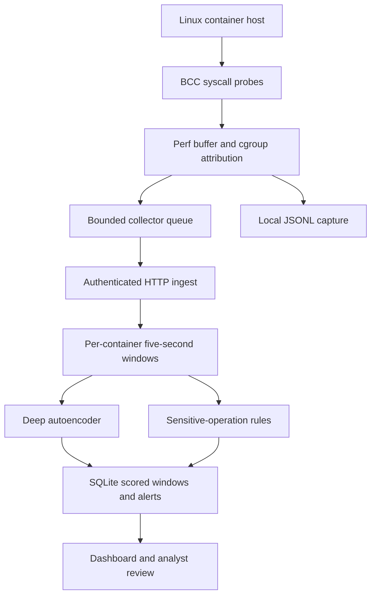

# Architecture and detector mechanics

## Observation

Entry probes save cgroup, PID/TID, UID, process name and supported pathname. Exit probes emit return status. Entry identity remains available when a task calls `setns` or changes context. Pending entries are keyed by PID/TID and cleaned on task exit. Perf-buffer loss is tracked by BCC callbacks. The collector resolves runtime identity in userspace and skips unrecognised host events, unless a cgroup is explicitly selected.

## Features

Each nonempty five-second `(source, container, receive-time bucket)` window becomes 20 features:

- 14 operation counts: `execve`, `openat`, `connect`, `mount`, `umount2`, `setns`, `unshare`, `ptrace`, `bpf`, `clone`, `clone3`, `chmod`, `fchmodat`, `chroot`.
- Counts of failed operations, UID-0 events and distinct PIDs.
- Counts of sensitive-resource paths, runtime-socket paths and shell execution.

Apply `log(1+count)`, then standardize with training mean and standard deviation (floor 0.25). Counts depend on traffic volume: workload-specific normal baselines matter. Empty windows are not scored. Last active container records expire after an hour.

## Autoencoder

Input/output 20 dimensions; hidden dimensions 32,16,4,16,32. Tanh hidden activation, linear output. Minibatch Adam minimizes mean squared normalized reconstruction error. Adam learning rate 0.002; deterministic random seeds; clipped gradients. Training split 70%, calibration 15%, test 15%. For real captures split sorted time-window records; synthetic windows use independently generated random examples. The trained model's 99th-percentile normal calibration error is the anomaly threshold.

A score above threshold raises a behavioral alert. The largest feature reconstruction errors are shown as **error attribution**, not proof of causality or a predicted attack type. Rules independently alert on selected sensitive syscalls/resource paths. A rule + anomaly is labelled hybrid. No isolation/blocking action is performed.

## Reliability and persistence

Collector queue capacity 10,000, delivery batches at most 200, timeout 2s. Retry batches expire after 50s. Local JSONL retains collected events even if delivery fails. Lost/perf-buffer, queue, and transport errors are separate metrics. Backend caps 5,000 events per window and 2,000 active pending windows. SQLite stores raw events, scored windows and alerts, with seven-day pruning. No database size quota; tune/rotate for sustained workloads. Health check is service liveness; heartbeat freshness is separate.

No cluster aggregation, sequence autoencoder, response automation, vulnerability exploitation, or guaranteed zero-day detection is claimed.
